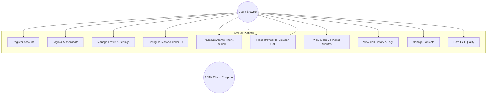
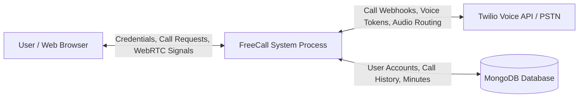
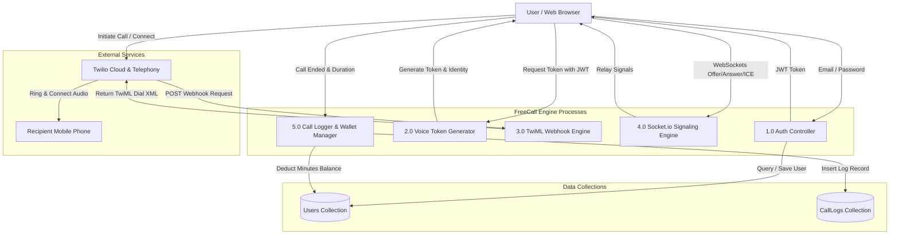
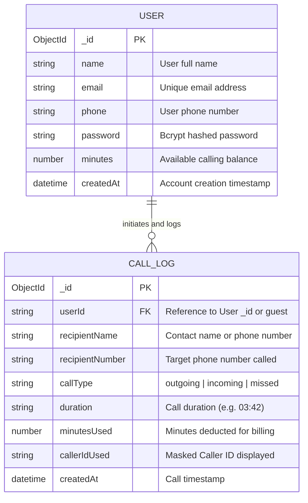
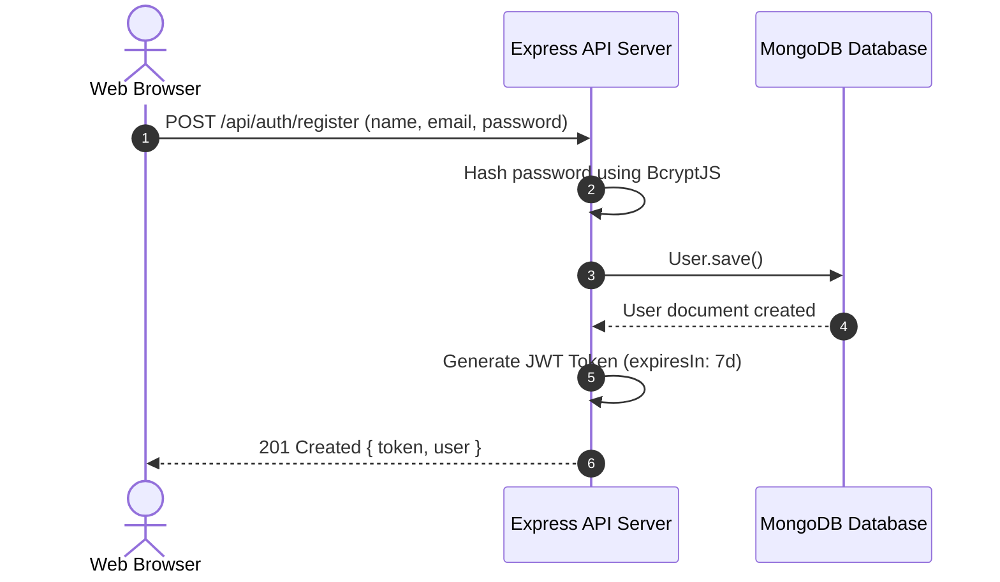

# 📞 FreeCall — Comprehensive Technical Design Document

This document provides a complete architectural and technical specification for the **FreeCall** real-time voice communications application. It includes Use Case Diagrams, Data Flow Diagrams (DFD Level 0 & Level 1), Entity-Relationship (ER) Diagrams, Sequence Diagrams, API Specifications, and Data Schemas.

---

## 📑 Table of Contents

1. [Executive Summary](#1-executive-summary)
2. [High-Level System Architecture](#2-high-level-system-architecture)
3. [Use Case Diagram](#3-use-case-diagram)
4. [Data Flow Diagrams (DFD)](#4-data-flow-diagrams-dfd)
   - [DFD Level 0 (Context Diagram)](#dfd-level-0-context-diagram)
   - [DFD Level 1 (Detailed Data Flow)](#dfd-level-1-detailed-data-flow)
5. [Entity-Relationship (ER) Diagram](#5-entity-relationship-er-diagram)
6. [Sequence Diagrams](#6-sequence-diagrams)
   - [Authentication Sequence](#authentication-sequence)
   - [Browser-to-Phone (PSTN) Call Sequence](#browser-to-phone-pstn-call-sequence)
   - [Browser-to-Browser WebRTC Signaling Sequence](#browser-to-browser-webrtc-signaling-sequence)
7. [Database Schema Reference](#7-database-schema-reference)
8. [API Route Specifications](#8-api-route-specifications)
9. [Deployment & Tunneling Setup](#9-deployment--tunneling-setup)

---

## 1. Executive Summary

**FreeCall** is a full-stack real-time voice communication platform enabling users to place voice calls directly from a web browser. The system supports two primary calling modes:
1. **WebRTC P2P Voice Calling**: Direct browser-to-browser audio streams between registered app users via WebSocket signaling.
2. **PSTN Phone Calling**: Browser-to-phone voice calling to standard mobile/landline numbers powered by the **Twilio Voice SDK** and **TwiML Webhooks**.

---

## 2. High-Level System Architecture

```mermaid
flowchart TD
    subgraph Frontend [freecall-app - React 19 / Vite]
        UI[User Interface & Components]
        Context[AppContext & SocketContext]
        TwilioSDK[Twilio Voice SDK v2]
        WebRTC[Browser WebRTC Media Engine]
    end

    subgraph Tunneling [Tunneling Layer]
        Ngrok[ngrok Public HTTPS Tunnel]
    end

    subgraph Backend [freecall-server - Express 5 / Node.js]
        AuthRoutes[/api/auth Routes]
        CallRoutes[/api/calls Routes]
        TwiMLCtrl[TwiML Controller]
        Signaling[Socket.io Signaling Server]
    end

    subgraph Storage [Data Layer]
        MongoDB[(MongoDB Database)]
        MemStore[(In-Memory Fallback Store)]
    end

    subgraph External [External Services]
        TwilioCloud[Twilio Voice Cloud]
        PSTN[Global PSTN Telecom Network]
    end

    UI <--> Context
    Context <--> TwilioSDK
    Context <--> WebRTC
    
    UI <-->|HTTP / REST| AuthRoutes
    UI <-->|HTTP / REST| CallRoutes
    Context <-->|WebSocket| Signaling
    
    Ngrok <-->|HTTPS Tunnel| CallRoutes
    TwilioCloud <-->|Webhook POST| Ngrok
    TwilioCloud <-->|SIP / PSTN Bridge| PSTN
    TwilioSDK <-->|WebRTC Voice Stream| TwilioCloud
    
    CallRoutes <--> MongoDB
    CallRoutes -.- MemStore
```

---

## 3. Use Case Diagram



---

## 4. Data Flow Diagrams (DFD)

### DFD Level 0 (Context Diagram)



### DFD Level 1 (Detailed Data Flow)



---

## 5. Entity-Relationship (ER) Diagram



---

## 6. Sequence Diagrams

### Authentication Sequence




### Browser-to-Browser WebRTC Signaling Sequence

```mermaid
sequenceDiagram
    autonumber
    actor Caller as Caller Browser
    participant Socket as Socket.io Server
    actor Callee as Callee Browser

    Caller->>Socket: emit("register", { userId: "caller@example.com" })
    Callee->>Socket: emit("register", { userId: "callee@example.com" })

    Caller->>Caller: getUserMedia({ audio: true })
    Caller->>Caller: createOffer()
    Caller->>Socket: emit("call-user", { to: "callee@example.com", offer })
    Socket->>Callee: emit("incoming-call", { from: "caller@example.com", offer })

    Callee->>Callee: getUserMedia({ audio: true })
    Callee->>Callee: createAnswer(offer)
    Callee->>Socket: emit("answer-call", { to: "caller@example.com", answer })
    Socket->>Caller: emit("call-answered", { answer })

    Caller<->Callee: Exchange ICE Candidates via Socket.io
    Note over Caller,Callee: Peer-to-Peer WebRTC Audio Channel Established
```

---

## 7. Database Schema Reference

### 1. User Schema (`models/User.js`)
```javascript
const UserSchema = new mongoose.Schema({
  name: { type: String, required: true },
  email: { type: String, required: true, unique: true },
  phone: { type: String, default: "+91 98765 43210" },
  password: { type: String, required: true },
  minutes: { type: Number, default: 12 },
  createdAt: { type: Date, default: Date.now },
});
```

### 2. CallLog Schema (`models/CallLog.js`)
```javascript
const CallLogSchema = new mongoose.Schema({
  userId: { type: String, required: true },
  recipientName: { type: String },
  recipientNumber: { type: String, required: true },
  callType: { type: String, enum: ["outgoing", "incoming", "missed"], default: "outgoing" },
  duration: { type: String, default: "0:00" },
  minutesUsed: { type: Number, default: 0 },
  callerIdUsed: { type: String },
  createdAt: { type: Date, default: Date.now },
});
```

---

## 8. API Route Specifications

| Method | Endpoint | Protection | Description |
|--------|----------|------------|-------------|
| `POST` | `/api/auth/register` | Public | Registers a new user and returns JWT token |
| `POST` | `/api/auth/login` | Public | Authenticates user credentials and returns JWT |
| `GET` | `/api/auth/me` | Bearer Token | Fetches current user profile and minutes balance |
| `GET` | `/api/calls/history` | Bearer Token | Fetches past call log history for the authenticated user |
| `POST` | `/api/calls/log` | Bearer Token | Logs a new completed call and deducts wallet minutes |
| `POST` | `/api/calls/add-minutes` | Bearer Token | Adds purchased minutes to user wallet balance |
| `GET` | `/api/calls/voice-token` | Bearer Token | Generates signed Twilio Voice Access Token with VoiceGrant |
| `POST` | `/api/calls/twiml` | Public Webhook | Returns TwiML XML instructions to bridge audio to PSTN numbers |
| `POST` | `/api/calls/pstn` | Bearer Token | Initiates automated PSTN call via Twilio REST API |

---

## 9. Deployment & Tunneling Setup

- **Backend Server Port**: `5001` (Node.js/Express)
- **Frontend App Port**: `5173` (Vite / React 19)
- **Public Tunnel**: `ngrok http 5001`
- **Environment Variable**: `SERVER_URL=https://<your-ngrok-subdomain>.ngrok-free.dev`
- **Twilio TwiML App Request URL**: `https://<your-ngrok-subdomain>.ngrok-free.dev/api/calls/twiml`
